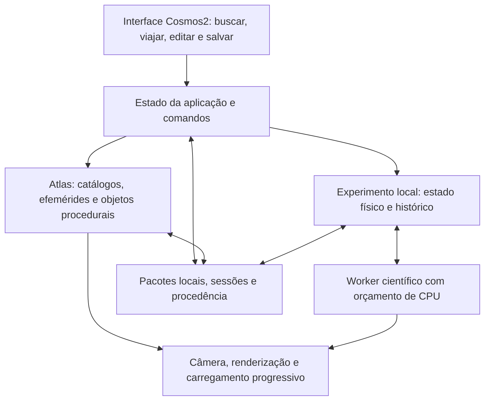

# Cosmos2 — plano diretor

Versão de planejamento4.1 —12/10/2026; meta de um mês estabelecida pelo dono.
Estado: pesquisa concluída; construção autorizada. C2-00/G0 aprovado localmente em12/10; C2-01, C2-02, C2-03, C2-18 e C2-19 em13/10. C2-06 aprovado14/10; ver as sete decisões locais. Demais marcos em construção.

[ROADMAP-GERAL.md](ROADMAP-GERAL.md) governa agora sequência, estado e horas:
27marcos no roteiro completo,21na v1 ampliada e6de aprofundamento. C2-00/C2-01/C2-02/C2-03/C2-06/C2-18/C2-19
aprovados localmente;20sem aceite completo,14deles na v1. IDs/aceites existentes preservados.
PLANO-UM-MES.md governa previsão atual: meta12/11/2026, cerca de seis cotas
completas equivalentes por semana; orçamento-base30 após renovação13/10.
Estimativas de horas da4.0 retiradas como previsão de prazo, sem calibração
de produtividade. Capacidade de uso não garante quantidade de marcos completos.
Novas frentes: matéria quântica, neutrinos,
plasma coletivo, dinâmica galáctica, cosmologia e integração ampliada.

O pedido de 12/10 amplia a entrega: interações gravitacionais mais profundas,
medição de campos eletromagnéticos, distorções gravitacionais e mais quantidade
e qualidade de conteúdo. Esses recursos passam a integrar a v1 ampliada. A correção seguinte do dono
prioriza as quatro forças, forte/fraca incluídas, seus cenários e controles
independentes de atuação/visualização; ver QUATRO-FORCAS.md.
Não são funcionalidades já implementadas. O protótipo atual valida a base.

## 1. Resultado pretendido

Construir um explorador e laboratório do universo para PC, com uma única
experiência de navegação. O usuário abre o aplicativo, encontra um objeto,
viaja até ele, observa sua superfície ou ambiente, entende os dados disponíveis
e pode criar uma experiência física a partir daquele sistema.

A ambição visual vem de SpaceEngine; a interação com as propriedades, de
Universe Sandbox; a organização de dados e escalas, de OpenSpace; a navegação
e extensibilidade, de Celestia. A análise e as fontes estão em
[PESQUISA-REFERENCIAS.md](PESQUISA-REFERENCIAS.md).

O projeto começa em pasta, arquitetura, interface e critérios novos. O Cosmos
anterior permanece preservado. Não há obrigação de usar Godot ou de portar
seus módulos. O conhecimento de problemas anteriores pode orientar perguntas;
seus testes e aceites não validam automaticamente o Cosmos2.

## 2. Decisões e hipóteses

| Situação | Decisão |
| --- | --- |
| Confirmado pelo dono | Começar do zero, investigar os quatro exemplos, planejar primeiro |
| Confirmado pelo dono | Palavras de retomada `cosmos2` e `cosmos 2` |
| Confirmado pelo dono | Godot não é obrigatório |
| Proposta | Windows nativo como plataforma principal; Linux depois da primeira versão |
| Proposta | Exploração visual e experimento no mesmo aplicativo |
| Proposta | Primeiro validar a experiência visual; gravidade entra cedo na prova técnica |
| Base aprovada em G0 local | OpenSpace0.22 como base visual e REBOUND5.2.2 no worker; módulos posteriores ainda exigem validação |
| Confirmado pelo dono em 12/10 | Aumentar profundidade das interações físicas, instrumentos para campos, efeitos gravitacionais e riqueza do conteúdo |
| Decisão desta revisão | Antecipar instrumentos e laboratórios científicos após a base visual; preservar exploração e aparência como requisitos |
| Autorizado posteriormente pelo dono | Construir localmente, preparar dependências, executar e validar; começar C2-00 e continuar o plano |
| Fora da autorização atual | Despesas e publicação |

Bibliotecas abertas reduzem trabalho de infraestrutura. “Do zero” não exige
descartar algoritmos, dados públicos e bases maduras. Qualquer reutilização
terá origem identificada e uma finalidade concreta.

## 3. Experiência que define o produto

O usuário deve conseguir realizar quinze percursos sem terminal ou ferramentas
externas. Eles são os critérios centrais de aceite:

1. **Da Terra às galáxias:** abrir na Terra, visitar a Lua e Saturno, afastar-se
   até as estrelas próximas, reconhecer a Via Láctea e visitar Andrômeda;
   voltar ao ponto inicial por um favorito.
2. **Da órbita à superfície:** aproximar-se da Lua e de um planeta procedural,
   distinguir relevo, iluminação, escala e origem dos detalhes; sair para a
   órbita sem perder o controle da câmera.
3. **Alterar um sistema:** selecionar o Sol, criar uma cópia para experimento,
   modificar massa ou velocidade, ver a resposta das órbitas e comparar com
   o estado inicial.
4. **Criar e colidir:** inserir um corpo por interface, pré-visualizar seu
   movimento, executar uma colisão simplificada e entender massa, energia e
   limitações do resultado.
5. **Continuar depois:** salvar localização e experimento, fechar o aplicativo,
   reabrir e recuperar câmera, tempo, parâmetros e estado físico compatíveis.
6. **Medir a gravidade:** colocar sondas entre corpos, inspecionar aceleração,
   potencial e gradientes de maré, editar o sistema e comparar medições.
7. **Experimentar campos elétricos e magnéticos:** inserir cargas, definir
   campos, lançar partículas e medir força, trajetória e energia.
8. **Explorar o magnetismo planetário:** medir o campo terrestre por posição
   e época, comparar com um dipolo e acompanhar partículas de teste.
9. **Comparar Newton e relatividade:** observar precessão e comparar relógios
   em cenários definidos, com gráficos e limites do modelo acessíveis.
10. **Investigar um buraco negro:** variar massa, rotação e observador,
    acompanhar raios de luz, lenteamento e regiões características.
11. **Investigar estrelas e exoplanetas:** comparar sistemas, luminosidade,
    temperatura, trânsito e curva de luz, separando dados e previsões.

12. **Investigar a interação forte:** alterar condições de uma reação nuclear,
    medir taxas, composição e energia, consultar a ligação dos núcleos.
13. **Investigar a interação fraca:** acompanhar decaimentos e capturas,
    medir meia-vida, produtos e perdas por neutrinos quando modeladas.
14. **Separar atuação e visualização:** alternar os dois controles para cada
    interação, manter referências visíveis e comparar consequências calculadas.
15. **Relacionar as quatro forças numa estrela:** comparar processos nucleares,
    gravidade, matéria/radiação e escalas de resposta térmica num modelo declarado.

Detalhes de interface e direção visual: [EXPERIENCIA.md](EXPERIENCIA.md).

## 4. Duas formas de explorar o mesmo espaço

**Atlas:** catálogos, efemérides e representações de referência. A linha do
tempo consulta modelos e dados na faixa em que são válidos. Dados observados
e objetos procedurais têm identificação própria. A vista pode conter milhões
de estrelas visuais sem integrar gravitacionalmente cada uma.

**Experimento:** uma cópia explícita de um conjunto de corpos, numa época e
referencial definidos. Aqui massa, posição, velocidade, raio e o multiplicador
de gravidade alteram a evolução calculada. O restante do Atlas é contexto
visual, sem influência física implícita.

É possível navegar pelo Atlas mantendo o experimento pausado ou ativo em
segundo plano dentro de seu orçamento. Não existem dois escritores simultâneos
da mesma órbita. Editar um corpo de referência oferece criar o experimento;
o catálogo de origem continua identificável e recuperável.

## 5. Conteúdo e escopo da v1 ampliada

A especificação detalhada está em [ESCOPO-CIENTIFICO.md](ESCOPO-CIENTIFICO.md).
As metas abaixo substituem o escopo menor da revisão 1.1; são metas propostas,
não recursos entregues ou acervo já instalado.

| Área | Entrega planejada |
| --- | --- |
| Solar | Sol, 8 planetas, 30 luas, 50 corpos menores; dados e cobertura temporal declarados |
| Destaques visuais | 12 mundos com ficha própria de qualidade, fenômenos e interações |
| Superfícies | Lua e Marte com relevo de fonte identificada; 4 famílias rochosas procedurais, 20 sementes de referência |
| Estrelas e sistemas | 100 mil estrelas básicas; meta de 1 milhão em pacote progressivo; 30 sistemas exoplanetários curados |
| Céu profundo | Via Láctea, Andrômeda e 30 objetos adicionais curados; volumes, modelos e imagens identificados |
| Gravidade | Editor completo, sondas, campo/potencial, marés, baricentro, ressonâncias, encontros, J2 e comparação |
| Eletromagnetismo | Campos E/B, cargas, força de Lorentz, trajetórias e laboratório eletrostático com interação mútua |
| Magnetismo planetário | Campo terrestre IGRF, comparação com dipolo, partículas de teste e ambientes com modelo declarado |
| Relatividade | Precessão, relógios, lenteamento e exploração de Schwarzschild/Kerr com trajetórias de luz |
| Instrumentos | Sondas, cortes, gráficos, comparação, curva de luz, espectro didático e exportação com unidades |
| Colisões e energia | Contato contínuo, fusão de esferas, spin e balanço térmico; efeitos separados do cálculo |
| Nuclear forte/fraca | Ligação, reações, decaimentos/capturas, composição, energia e neutrinos nos regimes validados |
| Controles das quatro forças | Atuação e visualização independentes, efeitos por processo, referência 3D e comparações hipotéticas identificadas |
| Biblioteca de experiências | 32 cenários reproduzíveis, com ação, medição, comparação e persistência |
| Uso e continuidade | PT-BR, navegação fluida, acessibilidade, histórico, recuperação e pacote Windows offline |

Catálogo grande não significa integrar todos os objetos ao mesmo tempo.
Detalhes desconhecidos permanecem desconhecidos ou hipóteses identificadas.
Não exigir a mesma textura, superfície ou precisão em objetos de naturezas
ou coberturas diferentes. Cada destaque precisa cumprir sua ficha de qualidade.
A v1 ampliada satisfaz J1–J15; C2-10 passa a ser uma entrega intermediária.

## 6. Modelos físicos e expansão posterior

As quatro forças, incluindo forte/fraca, e relatividade deixam de ser apenas
expansões futuras. Entram no plano principal com fronteiras e critérios próprios:

| Frente | Entrega da v1 ampliada | Extensão posterior |
| --- | --- | --- |
| Gravidade | N-corpos, campo e potencial, gradientes de maré, J2, marés de equilíbrio e sondas | Grandes populações com autogravidade e métodos aproximados validados |
| Eletromagnetismo | Campos prescritos, partículas de teste e Coulomb autoconsistente em cenário pequeno | Maxwell/PIC e plasma coletivo com retroação completa |
| Magnetismo | Modelo terrestre e comparação planetária, trajetórias e conjuntos de simulação identificados | MHD dinâmica interativa e emissão auroral física acoplada |
| Relatividade | Campo fraco, relógios e raios/geodésicas em métricas estacionárias | Relatividade numérica de métricas dinâmicas, fusões e ondas |
| Radiação | Fluxo, espectro didático, curvas de luz e efeitos selecionados com parâmetros | Transporte radiativo completo acoplado a gás |
| Nuclear forte/fraca | Redes de reações, ligação, abundâncias/decaimentos, captura e balanços com solver especializado | QCD dinâmica de hádrons e teoria quântica de campos completas |
| Fluidos/cosmologia | Visualização de modelos ou snapshots quando usados, com procedência | Hidrodinâmica de impactos, formação de estruturas e simulações próprias |

O recorte torna os fenômenos solicitados calculáveis e verificáveis na máquina
alvo. Frentes posteriores exigem revisão específica antes de integrar novos
solvers. Nenhuma imagem de partículas substitui um modelo de fluido, plasma
ou reação nuclear. Detalhes, candidatos e fontes estão no escopo científico.

## 7. Arquitetura recomendada

Continuar a prova com OpenSpace v0.22.0 fixado no protótipo,
Windows nativo, interface própria e worker gravitacional. A base visual deve
ser extensível por módulos e perfis, com mudanças pequenas no núcleo. Não
instalar um fork completo e assumir que a integração já está resolvida.

Contratos, relógios, coordenadas, dados e falhas estão em
[ARQUITETURA.md](ARQUITETURA.md). Métricas e portas de aceite estão em
[VALIDACAO.md](VALIDACAO.md).

## 8. Sequência de execução ampliada

**21 marcos da v1, C2-00–20. C2-00, C2-01, C2-02, C2-03, C2-06, C2-18 e C2-19 aprovados localmente;14marcos restantes.**
Mais6marcosC2-21–26 detalhados emROADMAP-GERAL.md, com orçamento separado.
O protótipo contém provas que serão reaproveitadas, sem equivaler ao aceite dos
marcos completos. IDs antigos permanecem; C2-10 muda de candidata final para
entrega intermediária. C2-18/19/20 cobrem forte, fraca e integração estelar. Os IDs preservam o
histórico; C2-17 continua o aceite final e depende também dessas entregas.

| Marco | Dependência | Entrega observável e condição de saída |
| --- | --- | --- |
| C2-00 — prova da base | Autorizada | Windows/Radeon, build próprio, offline, Terra–Lua–Via Láctea, interface e worker; decisão G0 |
| C2-01 — contratos e conteúdo inicial | C2-00 | IDs, unidades, referenciais, tempo, pacotes e contrato de campos/sondas; fontes e cobertura |
| C2-02 — navegação e interface | C2-01 | Busca, seleção, câmera, árvore, tempo, favoritos e PT-BR; Terra–Lua–Saturno |
| C2-03 — referência visual | C2-02 | Terra/Lua/Saturno com luz, atmosfera/anéis e percurso; três fichas visuais aprovadas |
| C2-04 — atlas entre escalas | C2-03 | Estrelas, Via Láctea, Andrômeda, catálogo progressivo; viagem e retorno |
| C2-05 — superfícies e geração | C2-04 | Lua/Marte, 4 famílias rochosas, 20 sementes; terreno contínuo e sistema editável |
| C2-06 — experimentação gravitacional | C2-03 | Editor de corpos, 128 massivos, sondas básicas, pausa e comparação; antecede expansão completa do Atlas |
| C2-07 — colisões e energia | C2-06 | Contato contínuo, fusão, spin, calor e balanço; três cenários reproduzíveis |
| C2-08 — histórico e recuperação | C2-05 e C2-07 | Sessões portáveis, ramificações, comparação e exportação; sondas persistidas quando presentes |
| C2-09 — desempenho e pacote base | C2-08 | J1–J5, métricas, falhas, instalação e reabertura offline sem ambiente de desenvolvimento |
| C2-10 — entrega intermediária | C2-09 | Build demonstrável e guia; não encerra o pedido de ciência e conteúdo ampliados |
| C2-11 — instrumentos e gravidade avançada | C2-06 | Campo/potencial, gradientes, Lagrange, J2/marés, gráficos e J6; perfil 256 e partículas de teste medido |
| C2-12 — laboratório eletromagnético | C2-11 | Campos E/B, Lorentz, cargas e Coulomb; J7 e cinco cenários com referências analíticas |
| C2-13 — magnetismo planetário | C2-12 e C2-04 | IGRF, dipolo, partículas e ambiente declarado; J8 e três cenários |
| C2-14 — relatividade em campo fraco | C2-11 | Precessão, relógios e lente pontual; J9 e comparações quantitativas |
| C2-15 — buracos negros e luz | C2-14 | Schwarzschild/Kerr, observador, raios e imagem relativística; J10 e validação de geodésicas |
| C2-16 — conteúdo e observatório | C2-05, C2-07, C2-13, C2-15 e C2-20 | Metas do acervo, 12 mundos em destaque, 32 experiências, instrumentos estelares e J11 |
| C2-17 — integração e candidata v1 ampliada | C2-10, C2-16 e C2-20 | J1–J15, persistência dos novos modelos, limites de recurso, pacote offline, revisão científica/visual e demonstração |

| C2-18 — interação forte e núcleos | C2-01 | J12/J14: taxas, ligação, cenários nucleares, controle de atuação/visualização e referência científica |
| C2-19 — interação fraca | C2-01 | J13/J14: decaimentos, capturas, produtos/neutrinos, controles e referência científica |
| C2-20 — quatro forças e região estelar | C2-11, C2-12, C2-18 e C2-19 | J15: rede pp/CNO, balanços e resposta térmica no regime declarado; efeitos não instantâneos |

Prioridade do dono: começar pelas quatro forças e seus palcos. Executar uma
fatia vertical inicial de C2-01/11/12/18/19 sobre o runtime oficial existente:
contratos, controles, cálculo, visualização e validação de um caso por força.
Isso não aprova C2-00 nem os marcos completos. Resolver a compilação própria
sem transformar o catálogo/visual final em pré-condição para iniciar a ciência.

Ordem de conclusão dos marcos: **00 → 01 → 18 → 19 → 02 → 03 → 06 → 11 →
12 → 20 → 14 → 04 → 05 → 07 → 08 → 09 → 10 → 13 → 15 → 16 → 17**.
Salvamento acompanha cada módulo; C2-08/17 consolidam compatibilidade. Domínios,
semântica dos botões, referências e primeiras provas: QUATRO-FORCAS.md.

A estimativa histórica de 432–768 horas de engenharia (540–1.075 com reserva)
se referia à revisão 1.1 e **não representa o novo total nem esforço restante**.
Não converter essa faixa em prazo, sessões ou cota Codex. A ampliação acrescenta
solvers, conteúdo e validação suficientes para exigir nova estimativa.

G0 foi aprovado; a previsão atual após as primeiras provas científicas está
emROADMAP-GERAL.md. Reestimar os módulos após uma prova pequena por
família (campo/partículas, IGRF e geodésicas). Registrar separadamente adaptação,
conteúdo, validação e integração. Relatividade visual, marés e memória dos
campos são riscos de esforço alto. Não anunciar data final antes dessas provas,
nem aumentar silenciosamente o orçamento de C2-00 para absorver a ampliação.

## 9. Prova C2-00 especificada antes de investir

Roteiro histórico da prova, agora concluída com aceite localG0 emG0-DECISAO.md:

1. Registrar versões, espaço livre, ferramenta de compilação, driver e
   contexto gráfico real. Usar caminhos próprios do Cosmos2.
2. Conferir release e dependências; preparar o menor perfil que tenha Terra,
   Lua, campo de estrelas e representação galáctica, com dados locais.
3. Obter uma compilação Windows reproduzível e abrir a cena na RX 7600.
   WSL e renderização por software não aprovam o desempenho do produto.
4. Personalizar busca/seleção/tempo o suficiente para provar o controle pela
   interface Cosmos2. Testar foco do mouse, escala da interface e tela cheia.
5. Ligar um worker de 32 corpos por contrato de snapshots. Alterar uma massa,
   pausar, salvar e retomar uma cena pequena. Esta é uma prova de integração,
   não o aceite científico completo de C2-06.
6. Executar o roteiro e registrar métricas de [VALIDACAO.md](VALIDACAO.md).
   Estimar dependências, disco, gargalos e tamanho das alterações ao núcleo.
7. Decidir: continuar; corrigir um defeito delimitado dentro do marco; ou
   executar a prova alternativa descrita na pesquisa.

Decomposição proposta das 24–48 h de C2-00:

| Trabalho | Entrega da prova | Esforço |
| --- | --- | --- |
| Inventário e versões | Toolchain, dependências, licença, disco e versão gráfica identificados | 2–4 h |
| Cena mínima na GPU | Perfil pequeno e percurso; primeiro avaliar a execução oficial compatível com a release, antes de personalizar | 4–8 h |
| Build reproduzível | Compilação própria e pacote de interface correspondente; mesma cena do passo anterior | 6–12 h |
| Interface e worker | Comandos, revisão, pausa, snapshot e checkpoint mínimos; cenário P32 de VALIDACAO.md | 8–16 h |
| Medição e decisão | Artefatos da prova, riscos confirmados e reestimativa | 4–8 h |

Esta ordem permite identificar uma falha gráfica básica antes de investir
na integração. Um executável oficial que abre não substitui a compilação
própria nem aprova G0. Congelar logo na prova um contrato mínimo de unidades,
IDs, tempo e snapshots; C2-01 amplia esse contrato, sem depender de uma
reescrita do protótipo para corrigir unidades desconhecidas.

Se for necessária a prova alternativa de Celestia, reservar explicitamente
mais 24–48 h, primeiro dentro da reserva de incerteza da v1. Não somar esse
custo novamente caso já tenha sido consumido da reserva. Duas bases
reprovadas exigem revisão do caminho técnico e da estimativa antes de tentar
um terceiro motor. Isso não autoriza desenvolver três produtos em paralelo.

Não exceder o teto de esforço reestimado de C2-00 escondendo semanas de conserto
do motor. Se a base falhar, o resultado útil é o diagnóstico e a revisão de
arquitetura. O limite de horas do marco é gestão de projeto, independente das
cotas de uso da ferramenta.

## 10. Orçamento técnico proposto

Máquina identificada: Ryzen 5 5600, 6 núcleos/12 threads, RX 7600 e cerca de
32 GB de RAM. A especificação nominal da placa é 8 GB; a consulta WMI retornou
um campo de 32 bits próximo a 4 GB e não será usada para concluir a capacidade
real. Confirmar orçamento gráfico via runtime/DXGI na futura prova.
[Ficha AMD](https://www.amd.com/en/products/graphics/desktops/radeon/7000-series/amd-radeon-rx-7600.html).

Inventário local corrigido na retomada, 11/10/2026: C: com
252.711.976.960 bytes livres, aproximadamente 235,36 GiB, no momento da leitura.
Windows 11 Pro for Workstations, versão 10.0.26200. Git nativo foi localizado;
`cmake.exe`, `ninja.exe` e `cl.exe` não estavam no PATH da sessão consultada.
`vswhere.exe` não foi encontrado no caminho padrão do instalador. Isso não
prova ausência de toda instalação alternativa de ferramentas C++.

Toolchain preparado: Build Tools 2022/MSVC e CMake isolados, conforme o
resumo de retomada; compilação própria concluída e aprovada localmenteG0. O inventário
de espaço acima é histórico. Como provisão de planejamento, separar até 80 GiB para
fontes, ferramentas, builds e caches, mantendo 50 GiB livres no volume após
a preparação. Esses valores são reservas propostas, não tamanho de download
ou exigências oficiais do OpenSpace. Medir os pacotes reais antes de obtê-los
e reconferir espaço livre, que pode mudar. Não confundir esse ambiente de
desenvolvimento com o aplicativo entregue ao usuário.

| Recurso | Meta inicial, a validar |
| --- | --- |
| Imagem | 1920×1080, preset padrão, mediana de frame ≤16,7 ms e p95 ≤25 ms nas cenas usuais |
| Cena de superfície pesada | Mediana ≤33,3 ms e p95 ≤40 ms; declarar a classe da cena |
| Memória residente | Até 8 GiB somando processos do produto no roteiro padrão |
| VRAM | Orçamento alvo ≤5,5 GiB, ajustado ao orçamento disponível informado pelo sistema |
| CPU física | Até 4 threads de worker inicialmente; interface permanece responsiva |
| Instalação básica | Alvo ≤6 GiB com conteúdo de referência offline |
| Cache adicional | Teto padrão 10 GiB, inspecionável e removível sem apagar sessões |
| Conteúdo de alta resolução | Pacotes opcionais; mostrar tamanho e espaço necessário antes de obter |
| Primeiro uso | Abrir e explorar sem Python, compilador, terminal, conta ou rede após instalação básica |

Limites são metas de planejamento. Se alguma meta for inviável, registrar a
medição e revisar o escopo explicitamente; não declarar sucesso usando resolução
ou conteúdo diferente sem informar. Não há compra de hardware proposta.

## 11. Riscos, sinais e respostas

| Risco | Quando fica visível | Resposta prevista |
| --- | --- | --- |
| OpenSpace/driver AMD | C2-00, atmosfera, galáxia, redimensionamento | Isolar o recurso, registrar driver; avaliar alternativa se requisito central falhar |
| Interface própria cara | C2-00, entrada/foco/API | Provar operações reais cedo; manter API tipada e pequena |
| O resultado continua pouco atraente | C2-03, imagens e percurso | Melhorar materiais, luz, câmera e conteúdo antes de expandir catálogo |
| Tremor e perda de escala | C2-00/04, viagem longa e retorno | Coordenadas hierárquicas e diferenças locais; nunca apenas converter tudo para float |
| Sandbox disputa o estado com efemérides | C2-06 | Um provedor por objeto, ramificação explícita e relógios independentes |
| Aceleração destrói a precisão | C2-06/07 | Mostrar taxa efetiva, limitar avanço e custo; nunca pular passos silenciosamente |
| Catálogo ou texturas dominam memória | C2-04/05 | Níveis de detalhe, carregamento por região e orçamento de cache |
| Procedural é confundido com observação | C2-04/05 | Procedência por propriedade e apresentação clara no painel |
| Colisão parece hidrodinâmica real | C2-07 | Descrever modelo de esferas/fusão, auditar massa/energia e separar efeitos |
| Fork torna manutenção inviável | C2-00 e revisões | Preferir módulos; fixar release, documentar alterações e testar atualização em cópia |
| Licença/conteúdo impede pacote desejado | C2-01/09 | Inventário por componente; substituir, oferecer aquisição opcional ou ajustar distribuição |
| Campo desenhado diverge do cálculo | C2-11/12 | Avaliador comum, cache por revisão/tempo e comparação de sondas com referência |
| Regime físico inválido | C2-12–15 | Fixar domínio de velocidade/campo/observador; recusar combinações não validadas |
| Solvers disputam CPU e memória | C2-11–17 | Orçamento global, filas limitadas, pausa independente e medições por perfil |
| Raios relativísticos pesados | C2-15 | Referência CPU, qualidade progressiva e resolução declarada; comprovar navegação no hardware |
| Plano cresce sem entregar uso | Toda fase | Percursos J1–J15 e aceites científicos orientam os módulos; C2-17 encerra a v1 ampliada |

## 12. Como acompanhar e retomar

Cada marco terá um registro curto: resultado visível, arquivos alterados,
checagem adequada, limitações e próximo passo. Evidências relevantes ficam no
projeto; repetir testes só por mudança, falha ou risco novo. Não criar séries
de marcos administrativos que não avancem a experiência.

`LEIA-PRIMEIRO.md` é a entrada obrigatória. Atualizar etapa, autorização,
decisões, processos ativos, pendências, comando seguinte e telemetria de cota.
Ler somente as seções apontadas pelo resumo. As palavras `cosmos2` e `cosmos 2`
retomam este projeto; nunca o Cosmos original. A implementação local já está
autorizada. O pedido de ampliação atualiza o escopo, sem apagar provas existentes.

Próxima ação: C2-11, instrumentos gravitacionais e campo3D,
conformeROADMAP-GERAL.md. C2-18/19 têm decisões locais e limites próprios.
Não refazer a provaC2-00 sem regressão concreta nem pedir confirmação rotineira.
